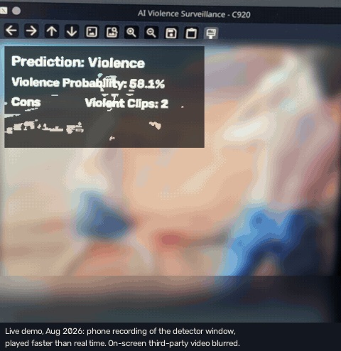
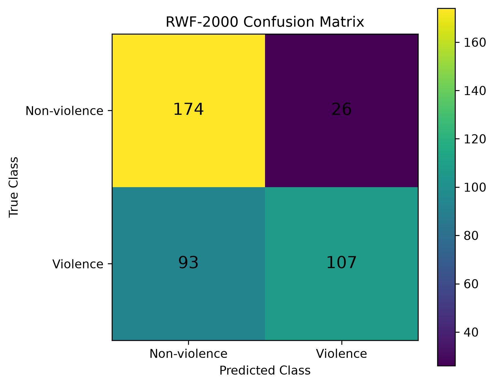

# Violence Detection Camera

An end-to-end research prototype that analyses video, flags possible violence, uses temporal
confirmation to suppress isolated alerts, and writes a human-readable incident report with a local LLM.
It was built for my MSc Robotics & AI dissertation at Queen Mary University of London (2025/26),
supervised by Arsen Abdulali.

> **Research question:** Can an AI-based video surveillance system improve early detection of
> antisocial behaviour compared with traditional CCTV monitoring?
> In practice, the project was scoped to **binary violence / non-violence detection**.

> **Status:** Research prototype from an MSc dissertation (viva 2 September 2026). It is not
> intended for operational use.

> **Authorship:** My original MSc research, implementation, experiments, results and dissertation were completed
> independently. In October 2026, I directed AI tools to reorganise, document, test and adapt my
> existing work for GitHub publication. I reviewed and approved these AI-generated portfolio
> changes. Details: [PROVENANCE.md](PROVENANCE.md).



*Live run on the author's workstation, August 2026: a phone recording of the detector window,
played faster than real time. The webcam was pointed at a third-party video on another screen;
that video is blurred, and only the detector's own overlay is kept (a few unrecoverable values are
left blank). It demonstrates
the pipeline; it is not an accuracy measure (see [Results](#results) and [docs/DEMO.md](docs/DEMO.md)).*

## Project timeline

This MSc project progressed from wider **intelligent security and surveillance research**
to the design, implementation and evaluation of a **video-based violence detector**.

| Phase | Period | Work |
|---|---|---|
| **Research and proposal** | Nov 2025 – Apr 2026 | Explored an autonomous security-rover concept, robotics and surveillance literature, and multimodal video/audio threat detection. The extended research review covered computer vision, deep learning, robustness and ethical risks. |
| **Scoping and system design** | Jun – Jul 2026 | Refined the implementation scope to binary violence detection; developed the R(2+1)D-18, RWF-2000, temporal-confirmation and Gemma explanation architecture. |
| **Implementation** | 30 Jul – 7 Aug 2026 | Developed Python training and inference scripts, produced a trained checkpoint, and made the first local Git commit (`d511aec`, 7 August), which is kept in the author's private archive. |
| **Evaluation and completion** | 11 Aug – 2 Sep 2026 | Evaluated RWF-2000 and selected UCF-Crime / XD-Violence subsets, tested the controlled live-camera prototype, and completed the final dissertation; viva on 2 September 2026. |

*The dates are supported by dated working files, saved source files and the original Git
history, all kept privately; [docs/TIMELINE.md](docs/TIMELINE.md) lists the kind of evidence
for each phase. Early rover and audio-fusion work informed the research; they are not presented
as features of the final implemented system. This repository's own Git history starts when the
public version was prepared and is not backdated.*

## Documentation

- [MODEL_CARD.md](MODEL_CARD.md): intended use, out-of-scope uses, results, limitations and ethics.
- [DATA.md](DATA.md): how to obtain each dataset, and their licences. No data is included here.
- [PROVENANCE.md](PROVENANCE.md): what was written for the dissertation, with original file fingerprints, and what changed afterwards.
- [docs/TIMELINE.md](docs/TIMELINE.md): the November 2025 – September 2026 research chronology.
- [docs/DEMO.md](docs/DEMO.md): how the live-demo recording is made, and what may appear in it.
- [results/README.md](results/README.md): what each results file contains, and what isn't published.

## How it works

```
Video (file or webcam)
   │  OpenCV: 16-frame clips, stride 8, resized to 112×112, Kinetics-400 normalisation
   ▼
R(2+1)D-18 classifier  ── pretrained on Kinetics-400, frozen backbone, new 2-class head
   │  violence probability per clip
   ▼
Temporal confirmation  ── alert only after 3 consecutive clips ≥ 0.50
   │  confirmed event (+ CSV log)
   ▼
Gemma 3 (local, via Ollama) ── writes a short incident report for a human operator
```

Gemma receives structured event data (probabilities, clip counts, timing), not the video itself,
and never makes the detection decision. That stays with the vision model and the temporal rule,
so the operator keeps control.

## Results

The metrics below were reported in the dissertation. Counts and metrics for every evaluation are
in [`results/summary.csv`](results/summary.csv). The three full-pipeline rows were recomputed from
the per-video result files. Those files name dataset videos, so they are kept in the author's
private archive and are not published here. The standalone classifier figures are as reported in
the dissertation.

| Evaluation | Videos | Accuracy | Precision | Recall | F1 |
|---|---|---|---|---|---|
| Classifier, RWF-2000 validation | 400 | **81.50%** | 80.00% | 84.00% | **81.95%** |
| Full pipeline (temporal rule), RWF-2000 | 400 | 70.25% | 80.45% | 53.50% | 64.26% |
| Full pipeline, UCF-Crime selected subset (no retraining) | 200 | 75.50% | 78.02% | 71.00% | 74.35% |
| Full pipeline, XD-Violence subset (no retraining) | 284 | 57.39% | 55.02% | 80.99% | 65.53% |

**What the numbers say:**
- **The full pipeline is precise but misses violence.** On RWF-2000, precision stays high, but 93 of
  200 violent videos never reach three positive predictions in a row. No ablation was run, so this
  drop can't be attributed to the temporal rule alone.
- **Cross-dataset behaviour differs a lot.** UCF-Crime is the most balanced. XD-Violence catches
  81% of violence but flags 94 of 142 normal videos, a domain-shift problem that a single
  benchmark would have hidden.
- **Live demo (Logitech C920, ~30 fps, RTX 5070 Ti):** classification, confirmation, logging and
  Gemma reports ran as one pipeline in controlled sessions on 12–15 August 2026. At about 30 fps,
  the 3-clip rule adds about 0.53 s between the first and the third positive clip (two further
  8-frame strides); the script reported this with every alert. This is a controlled
  demonstration, not a measurement of real-world incident-to-alert latency.



## Repository layout

| Path | Purpose |
|---|---|
| `model.py` | R(2+1)D-18 with Kinetics-400 weights, frozen backbone, dropout + 2-class head |
| `dataset.py`, `video_utils.py` | RWF-2000 loader (NonFight = 0, Fight = 1), clip sampling, transforms |
| `train.py` | Training on RWF-2000 train split (Adam, lr 1e-3, batch 2, 5 epochs) |
| `evaluate.py` | Classifier metrics on RWF-2000 validation |
| `temporal_rule.py` | The alert rule (0.50 threshold, 3 consecutive violent clips), shared by `predict.py`, the evaluators and the live camera; unit-tested against the original logic |
| `predict.py`, `batch_evaluate.py` | Video-level prediction with the 3-consecutive-clip rule |
| `ucf_evaluate.py`, `xd_evaluate.py`, `evaluation_io.py` | Cross-dataset evaluation without retraining, one video per CSV row |
| `live_camera.py`, `live_options.py`, `camera_test.py` | Webcam pipeline with alerts, cooldown, CSV logging and an optional demo recording |
| `gemma_utils.py` | Incident report generation with Gemma 3 through Ollama |
| `plot_rwf_results.py` | The figures in `results/rwf/figures/`, drawn from a `batch_evaluate.py` results file |
| `tools/` | `summarise_results.py` (summary table from per-video results) and `verify_reference_environment.py` |
| `tests/` | Standard-library tests, offline PyTorch smoke tests and headless live-camera tests |
| `train_*_working.py` | Early training experiments, kept for history |

## Running it

**Without any data** (no datasets, GPU or private files), you can check the code and run the tests:

```bash
python -m compileall -q *.py tests tools
python -m unittest discover -s tests -v
```

Without PyTorch and OpenCV, the offline smoke tests and headless live-camera tests are skipped.
With the CPU reference environment below, they also run. They build the model with random
weights, write a synthetic video, run `predict.py` end to end, check that a saved checkpoint
reloads exactly, and drive `live_camera.py` with a fake camera. Any pretrained-weight download is
blocked, so they need no network, dataset or checkpoint. They show that the code runs; they do
not reproduce the dissertation results.

**With licensed data** (each dataset obtained from its owners; see [DATA.md](DATA.md)):

1. Install Python 3.10+, a CUDA-capable PyTorch, and `pip install -r requirements.txt`.
   Versions weren't pinned during the project.
2. Place the datasets locally. **They are not included here.**
   - RWF-2000 → `data/rwf2000/RWF-2000/{train,val}/{Fight,NonFight}/*.avi`
   - UCF-Crime and XD-Violence (evaluation only), laid out as described in [DATA.md](DATA.md)
3. Train: `python train.py`. This writes `best_frozen_model.pth`. No weights are published.
4. Evaluate: `python evaluate.py` and `python batch_evaluate.py` (which writes
   `results/rwf/rwf_400_results.csv`, then `python plot_rwf_results.py` draws the figures).
   One video: `python predict.py path/to/video.avi --checkpoint best_frozen_model.pth` (add `--no-gemma` to skip the report).
5. Cross-dataset evaluation, one video per CSV row:

   ```bash
   python ucf_evaluate.py --checkpoint best_frozen_model.pth   # writes results/ucf/ucf_200_rerun.csv
   python xd_evaluate.py --checkpoint best_frozen_model.pth    # writes results/xd/xd_284_rerun.csv
   # Or set VIOLENCE_CHECKPOINT_PATH instead of passing --checkpoint; --output chooses another path.
   ```

   To rebuild the summary table from your own runs, write the outputs to
   `results/ucf/ucf_200_results_tidy.csv` and `results/xd/xd_284_results_tidy.csv` (the paths
   `tools/summarise_results.py` reads), then run `python -m tools.summarise_results --write`.
   Your numbers will reflect your checkpoint and data; they do not regenerate the historical
   dissertation metrics.
6. Live demo: install [Ollama](https://ollama.com) and `ollama pull gemma3`, then `python live_camera.py`.
   Add `--no-gemma` to skip the reports, or `--record outputs/live_demo.mp4` to save the annotated
   window (see [docs/DEMO.md](docs/DEMO.md)). With `--record`, alerts go to `outputs/demo_alerts.csv`;
   without it, they are appended to `results/live/live_alerts.csv`.

## Optional pinned CPU reference environment

The original 2026 training environment was not captured as a lockfile.
For prospective development, `requirements-reference-py313.txt` records a
**verified Linux CPU / Python 3.13 reference combination**, including
PyTorch 2.10.0 and Torchvision 0.25.0. It was first verified on
**27 October 2026 with Python 3.13.16**, and the reference-environment workflow in
`.github/workflows/` re-checks it on every change: it installs all eight pinned packages,
constructs R(2+1)D-18 without downloading weights and runs the full test suite.
This is **not** a reconstruction of the dissertation's original package versions or its
RTX 5070 Ti CUDA setup.

For a fresh Python 3.13 virtual environment, select a
[matching PyTorch CPU or CUDA build](https://pytorch.org/get-started/previous-versions/)
for your hardware first. For a CPU-only setup, for example:

```bash
python -m pip install torch==2.10.0 torchvision==0.25.0 --index-url https://download.pytorch.org/whl/cpu
python -m pip install -r requirements-reference-py313.txt
python -m tools.verify_reference_environment
```

The verification checks package versions, imports and constructs
R(2+1)D-18 with **no pretrained-weight download**. It does not verify
CUDA, model accuracy, real-video inference or full dependency hashes.
For an **RTX 50-series / Blackwell GPU**, select a compatible
CUDA 12.8 or 13.0 PyTorch wheel (`cu128` or `cu130`, not `cu126`);
see [official PyTorch version-specific installation commands](https://pytorch.org/get-started/previous-versions/).
**Those GPU builds have not been verified on this project's hardware.**
The original `requirements.txt` remains available and unpinned to avoid
misrepresenting the historical environment; this reference is a prospective
CPU-tested starting point.

## Known limitations

- **Training-protocol change for future experiments:** The original dissertation
  training code saved the **final epoch's weights** once after five epochs (provided
  final validation accuracy was above zero); it did **not** select the best epoch.
  The revised `train.py` instead selects the highest-accuracy checkpoint over the
  five epochs on the RWF-2000 `val` split. Because that same split is used to
  report the standalone classifier result (81.50%), future accuracy measured
  there is optimistically biased by checkpoint selection and **must not be
  compared directly** with the dissertation result. For an unbiased evaluation,
  choose checkpoints on a separate hold-out carved from `train`, then evaluate
  only once on the untouched `val` split. Neither the historic checkpoint nor
  the dissertation results are regenerated or changed by this revision.
- Full end-to-end runs need locally obtained datasets and a trained checkpoint; neither is
  published.
- Binary violence/non-violence only. The threshold and the 3-clip rule haven't been tuned, and no
  ablation was run on the temporal rule.
- It hasn't been tested on operational CCTV footage or against human operators, so it can't claim
  to beat trained CCTV staff.
- Gemma's reports were judged qualitatively; there's no quantitative measure of explanation quality.
- The headline metrics come from the dissertation runs. The pipeline and cross-dataset figures were
  recomputed from per-video results that are kept privately; the classifier figures were printed by
  `evaluate.py` and need the unpublished checkpoint to re-run.

## Privacy and ethics

No datasets, raw camera recordings, per-video results or model weights are stored in this repository.
The demo GIF is a short, redacted excerpt of a live session: the third-party video on screen is
blurred so that no one in it can be identified (see [docs/DEMO.md](docs/DEMO.md)).
The per-video evaluation records name dataset videos, many of them YouTube video IDs of real
people, so they stay in the author's private archive. Any use on real video may process personal
data and requires privacy, fairness and security review, with a human in the loop. See
[MODEL_CARD.md](MODEL_CARD.md) for intended and out-of-scope uses.

## Licence

No licence is granted. The code is shared so it can be read as part of a portfolio.
All rights are reserved by the author, so please ask before reusing it. The datasets, the Kinetics-400
weights and Gemma are covered by their own terms (see [DATA.md](DATA.md)).

---
Dylan Balysma · MSc Robotics & AI, Queen Mary University of London
